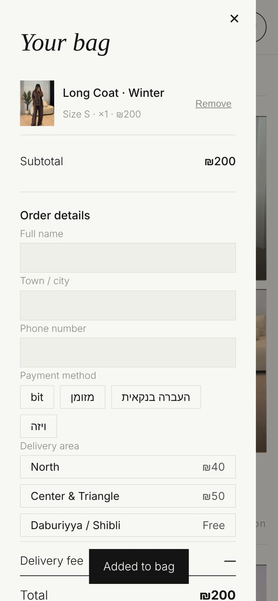
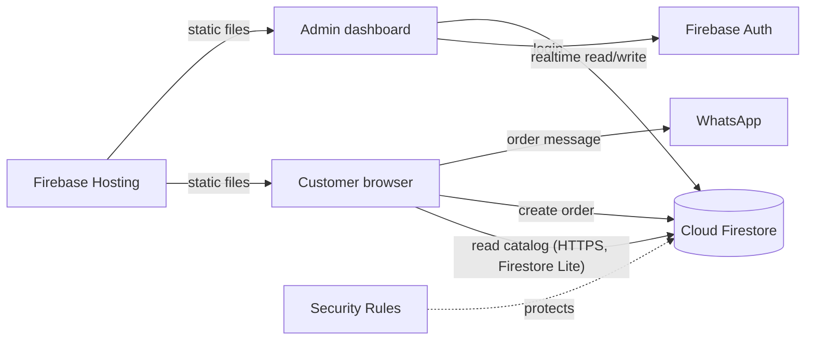

# MS Brand Clothing — Online Store & Admin Dashboard

A full-stack, serverless e-commerce web app for a real women's clothing boutique.
Customers browse seasonal collections, pick sizes and colors, and send their order straight to the shop's **WhatsApp**.
The shop owner manages everything — products, photos, prices, categories, covers and incoming orders — from a private **admin dashboard**, without touching code.

**Live site:** https://ms-brand0.web.app


| Category (mobile) | Product | Bag & checkout |
|---|---|---|
|  |  |  |

---

## Features

### Storefront
- Summer / Winter collections with categories managed from the admin
- Product cards with **multi-photo slider** (arrows, swipe, `1/3` counter)
- One product can appear in **several categories**
- Sale prices, sold-out sizes, hidden products
- Shopping bag, delivery areas with fees, payment method
- Checkout sends a formatted order to **WhatsApp** (with product links) and saves it to the database
- Shareable product pages (`/p?id=...`)
- Mobile-first design, works inside Instagram / WhatsApp in-app browsers
- Offline-friendly: last loaded catalog is cached on the device (IndexedDB), with automatic retries

### Admin dashboard (`/admin`)
- Secure login (Firebase Authentication), change password
- **Orders**: live list, status (new → paid → shipped …), customer details, product photos
- **Products**: add / edit / delete, up to 5 photos per item (client-side compression), sizes, colors, sale price, visibility, extra categories
- **Categories**: add, rename, reorder, remove — for each season
- **Covers**: homepage hero image and category cover photos (auto-shrunk for speed)

### Backend & security
- **Cloud Firestore** as the database (products, orders, categories, covers, settings)
- **Firestore Security Rules**: the public can read the catalog and *create* validated orders only; reading orders and all writes are restricted to the admin account
- **Firebase Hosting** with cache headers and cache-busting asset versions

---

## Architecture



## Tech stack
| Layer | Technology |
|---|---|
| Frontend | HTML5, CSS3 (responsive, mobile-first), vanilla JavaScript (ES modules) |
| Backend (serverless) | Firebase: Cloud Firestore, Authentication, Security Rules |
| Hosting | Firebase Hosting |
| Tools | Firebase CLI, Playwright (automated end-to-end tests) |

## Project structure
```
public/
  index.html          storefront
  admin.html          admin dashboard
  p.html              shareable product page
  check.html          data health-check page
  css/                style.css, admin.css
  js/
    config.example.js settings template (copy to config.js)
    app.js            storefront UI (categories, slider, bag, checkout)
    order.js          storefront data layer (Firestore Lite, cache, retries)
    admin.js          admin dashboard logic
    firebase.js       Firebase init for the admin
    seed.js           initial catalog
  img/                images
firestore.rules.example   database security rules template
firebase.json             hosting config
```

## Run it yourself
1. Create a Firebase project and enable **Firestore** and **Authentication → Email/Password**. Add one user (the shop owner).
2. Copy the templates and fill in your values:
   ```bash
   cp public/js/config.example.js public/js/config.js
   cp firestore.rules.example firestore.rules      # put the admin email inside
   cp .firebaserc.example .firebaserc              # put your project id inside
   ```
3. Deploy:
   ```bash
   npm install -g firebase-tools
   firebase login
   firebase deploy
   ```

> `config.js`, `firestore.rules` and `.firebaserc` are listed in `.gitignore`, so private keys, emails and contact numbers are never committed.

---

Designed & developed by **Mohamed Shibli** — [GitHub](https://github.com/MOHOHAMED02).
Product photos and brand © MS Brand Clothing.